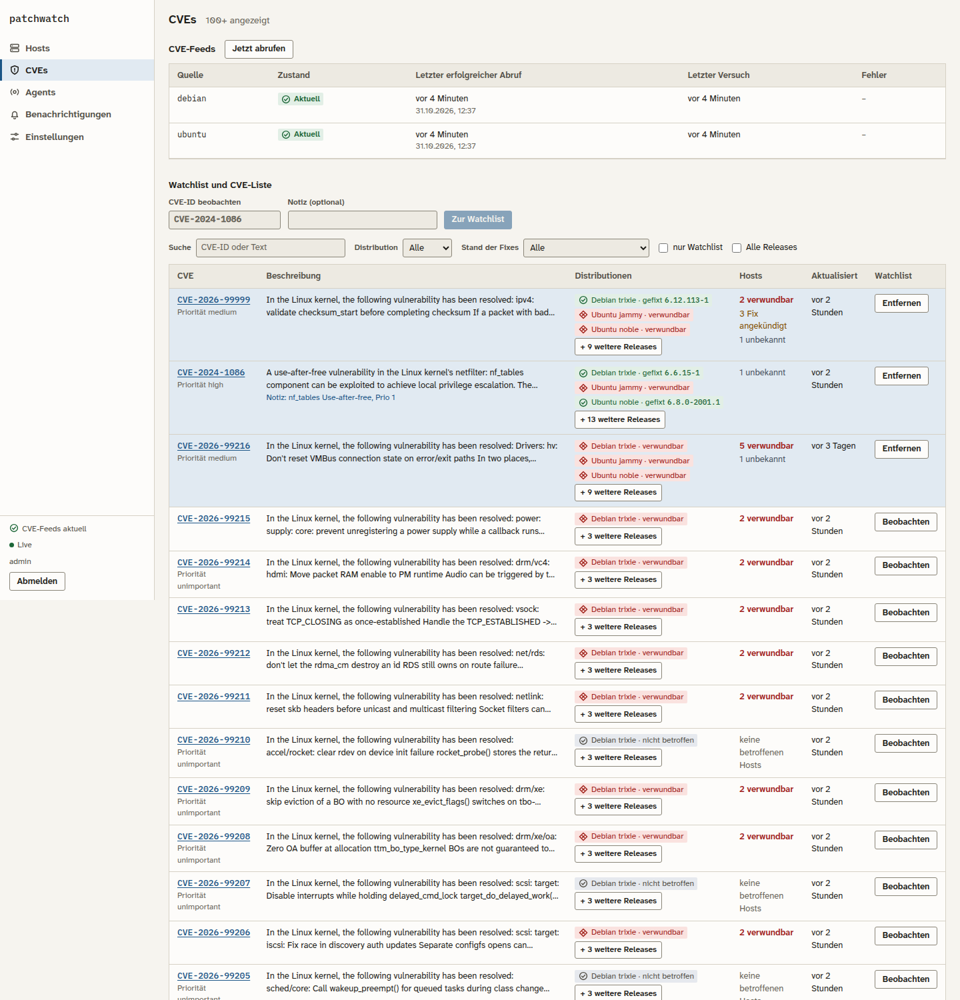
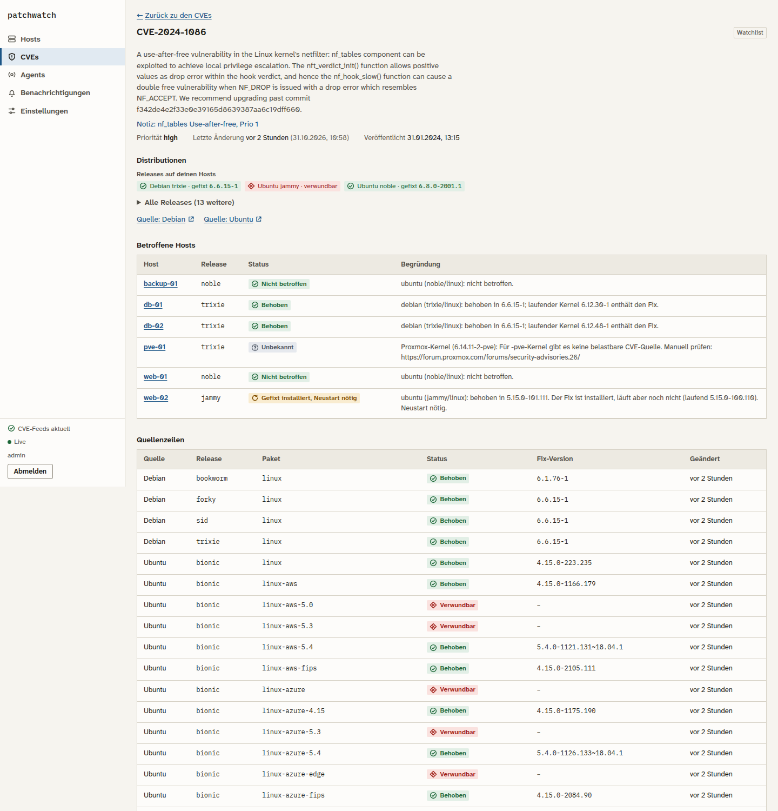
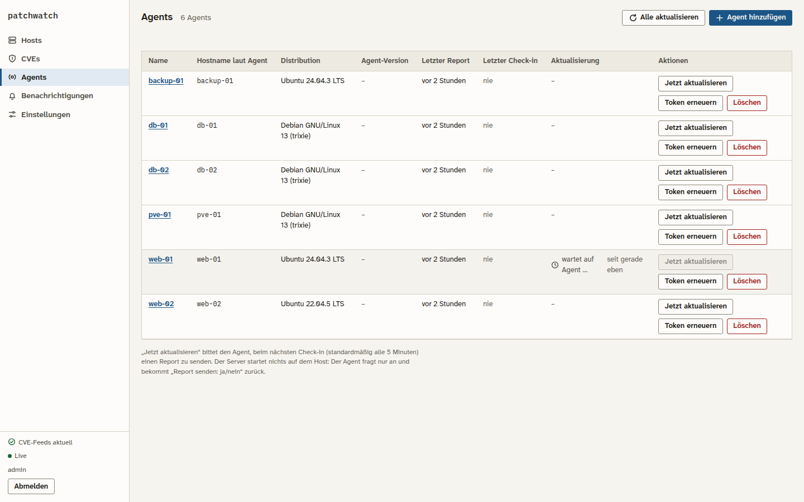
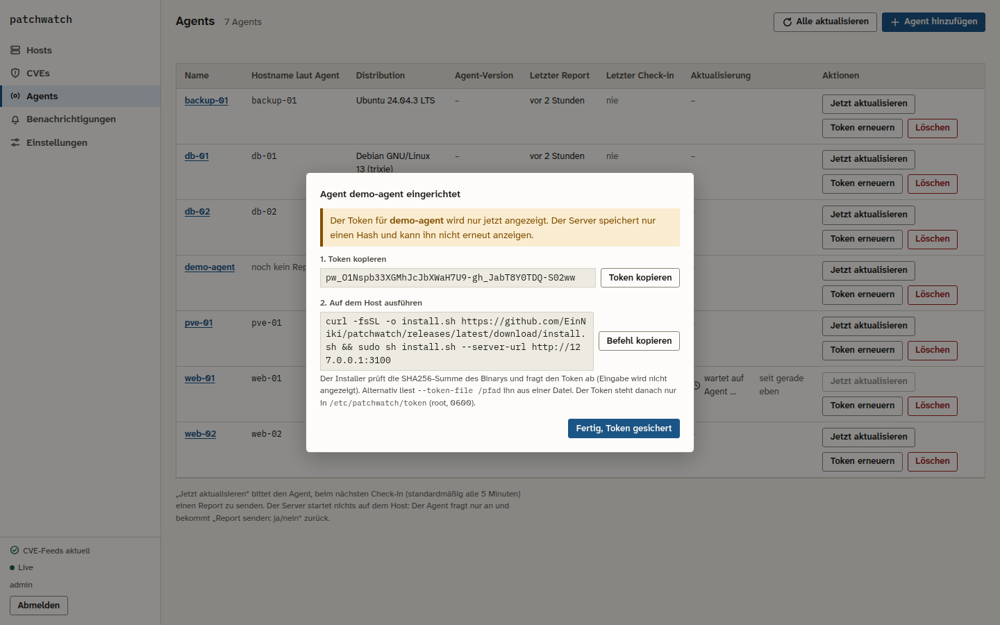
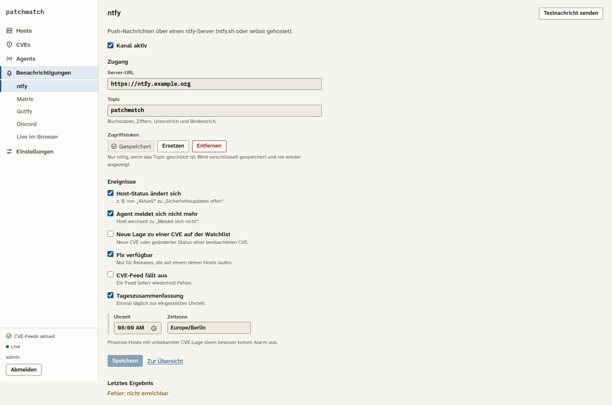
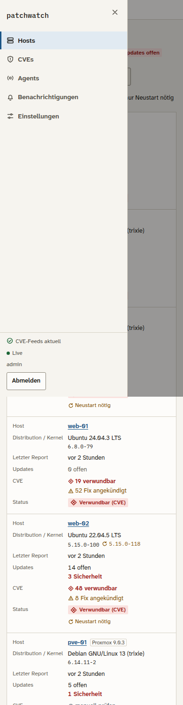

## Was ändert sich?
Basis: `feat/web` (gestapelt; nach dem Merge der vorherigen PRs Basis auf `main` stellen, **Merge-Commit**).
UI v1 bleibt reproduzierbar: Tag `design-v1`, Doku in `docs/design/v1/`.

**UI**
- Seitenleiste statt Kopfleiste: Hosts · CVEs · Agents · Benachrichtigungen · Einstellungen (mobil Off-Canvas mit Fokusfalle)
- Status-Chips mit Icon + Text; Design in `web/DESIGN.md` (v2), Referenz: Skill `hig` (ohne Apple-Muster, siehe `docs/design/v2/skills-review.md`)
- **CVEs**: Spalte „Distributionen“ (Chip je Quelle/Release), Standard nur Releases meiner Hosts, „Alle Releases“, Filter
  „Debian gefixt, Ubuntu offen“ und umgekehrt, Distro-Filter; neue Detailseite `/cves/<ID>` mit Quellen-Links und letzter Änderung
- **Agents**: Host- und Token-Verwaltung hierher verschoben; „Jetzt aktualisieren“/„Alle aktualisieren“ mit Live-Zustand
  „wartet auf Agent …“; „Agent hinzufügen“ zeigt den Token einmalig und einen Installationsbefehl **ohne** Token
- **Benachrichtigungen** (ntfy, Matrix, Gotify, Discord, Live im Browser) und **Einstellungen** (Passwort, Farbschema, Aufbewahrung)
- Live-Updates ohne Neuladen, Toasts für den Browser-Kanal

**Agent / Server**
- Check-in: zweiter systemd-Timer, `patchwatch-agent checkin`; Antwort nur `{"report_requested": bool}` (keine Befehle, kein Port)
- „Ja“ pro Anforderung genau einmal, Wiederholung nach 10 Min., 1 Anforderung je Host und Minute (DB-basiert)
- Kanäle als Trait; Konfiguration in der DB; Geheimnisse **XChaCha20-Poly1305 mit Kanalname als AAD**, write-only
  (`PATCHWATCH_SECRET_KEY` sichern, sonst unlesbar); SSRF-Schutz (aufgelöste IP geprüft und gepinnt, keine Redirects,
  Allowlist nur exakt, Loopback/Link-Local nie); Testnachricht liefert nur `ok` / `nicht erreichbar` / `HTTP <Code>`
- `fix_available` aus Feed-Änderungen nur, wenn die Release zu mindestens einem Host passt
- WebSocket `/api/v1/live`: nur mit Session und passender Origin, push-only, Session-Neuprüfung, Verbindungslimit
- `GET /cves` mit `distros`, `releases=mine|all`, `distro`, `split`; `GET /cves/{id}` mit Links, letzter Änderung, Hosts
- `POST /auth/password` (beendet andere Sitzungen), `GET|PUT /settings` (Aufbewahrung, vom Cleanup gelesen)
- **Keine Änderung an `eval.rs`** (Bewertungslogik)

## Neue Konfiguration
`PATCHWATCH_SECRET_KEY`, `PATCHWATCH_NOTIFY_ALLOWED_HOSTS`, `PATCHWATCH_ALLOWED_ORIGINS` (siehe README und `.env.example`);
Agent: `checkin_enabled`, `checkin_interval_secs`. Migration `0002_ui_v2.sql`.

## Geprüft
- fmt, clippy -D warnings, Rust-Tests (neu: Check-in, Kanäle/SSRF/Krypto, WebSocket, CVE-Distros, Passwort, Settings); Web: lint, typecheck, build
- E2E (`scripts/e2e-checkin.mjs`): Agent-Binary gegen lokalen Server, „Jetzt aktualisieren“ → genau ein Report, UI aktualisiert ohne Neuladen
- axe-core (WCAG 2.2 AA + Best Practice) hell/dunkel × Desktop/mobil, inkl. Dialogen und Menü: 0 Verstöße
- Screenshots in `docs/design/v2/screenshots/` (hell/dunkel, Desktop/mobil)

## Screenshots (Desktop, hell)
| CVEs | CVE-Detail |
|---|---|
|  |  |
| **Agents** | **Agent hinzufügen (Token einmalig)** |
|  |  |
| **Kanal ntfy** | **Mobil mit Menü** |
|  |  |

Closes #<UI-v2-Issues>
